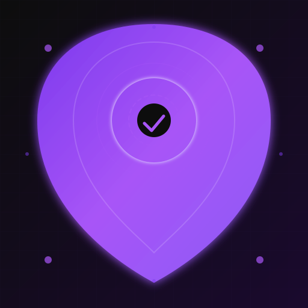

<p align="center">
  
</p>

<h1 align="center">Agent Guardian</h1>

<p align="center">
  <strong>Safety-first reliability for AI coding agents</strong>
</p>

<p align="center">
  <a href="https://github.com/Wrybill-env/AgentGuardian/actions"></a>
  <a href="https://pypi.org/project/agent-guardian/"></a>
  <a href="https://github.com/Wrybill-env/AgentGuardian/blob/main/LICENSE"></a>
  <a href="https://python.org"></a>
  <a href="https://github.com/Wrybill-env/AgentGuardian/releases"></a>
</p>

---

## The Problem

AI coding agents (Goose, OpenCode, Hermes, Codebuff) execute tools that modify files, run commands, and call APIs. When a stream fails — network glitch, rate limit, crash — **the agent may have already executed the tool**. Blindly retrying the prompt duplicates the side effect: a file gets written twice, a command runs twice, an API is called twice.

**Agent Guardian prevents this.** It observes the agent's event stream, tracks exactly what side effects have been observed, and only permits recovery when it can *prove* no ambiguous execution occurred.

---

## Core Safety Lifecycle

```
OBSERVE -> CLASSIFY -> VERIFY STATE -> CHECK SAFETY -> RECOVER ONLY WHEN PROVABLY SAFE
```

**The critical principle:**  
**`UNKNOWN` execution state = `UNSAFE` for automatic recovery.**

- Observing an error does **not** prove a tool didn't execute
- A valid checksum does **not** prove the state is fresh or that replay is safe
- A successful reconnect does **not** prove the prior turn completed safely
- A valid `loadSession` response does **not** prove the prior tool outcomes are known

> If a tool may have executed and its outcome cannot be established, **replay remains blocked**.

---

## How It Works

Agent Guardian provides a **generic, agent-agnostic safety core** plus **agent-specific adapters** that translate each agent's protocol into Guardian's unified event model.

### Architecture

```
+-----------------------------------------------------------------------------+
|                        GUARDIAN CORE (agent-agnostic)                       |
|  +--------------+ +-----------------+ +--------------+ +----------------+  |
|  | State Machine| | Failure Classifier| |  Safety Gate | |Recovery Executor|  |
|  |  (lifecycle) | |  (retry hints)   |  | (replay gate) | |  (budget+ladder)|  |
|  +--------------+ +-----------------+ +--------------+ +----------------+  |
|           ^                  ^                  ^                   ^       |
|           +------------------+------------------+-------------------+       |
|                                    |                                        |
+------------------------------------+----------------------------------------+
                                     |
         +---------------------------+---------------------------+
         v                           v                           v
+-----------------+         +-----------------+         +-----------------+
|  Hermes Adapter |         |  Goose Adapter  |         | OpenCode Adapter|
|  (in-process)   |         |  (ACP WebSocket)|         | (ACP stdio)     |
+-----------------+         +-----------------+         +-----------------+
         ^                           ^                           ^
         |                           |                           |
   In-process                   ACP over                    ACP over
   callbacks                    WebSocket                     stdio
```

**Each adapter implements the `AgentAdapter` protocol** — a single interface the core uses for observation, capability queries, and recovery actions.

---

## Safety Modes

| Mode | Behavior | Recovery Execution |
|------|----------|-------------------|
| `OBSERVE_ONLY` (default) | Observe, classify, report — **never executes recovery** | Blocked |
| `DRY_RUN` | Determine what *would* happen, report intended actions — **no side effects** | Simulated only |
| `AUTO_RECOVER` | **Explicit opt-in only** — executes recovery only when safety gate returns `SAFE` | When `SAFE` |

> `AUTO_RECOVER` is never enabled by default. It must be explicitly passed via `--safety-mode auto_recover` or config.

---

## Installation

```bash
# From PyPI (when published)
pip install agent-guardian

# From source
cd C:\Projects\AgentGuardian
pip install -e . --break-system-packages

# Verify installation
python -m guardian --help
```

**Requirements:**
- Python 3.11+
- At least one supported agent installed and running:
  - **Goose Desktop** (ACP WebSocket)
  - **OpenCode** (ACP stdio subprocess)
  - **Hermes** (in-process callbacks)
  - **Codebuff/FreeBuff** (HTTP/WebSocket — requires API token)

---

## Quick Start

### Observe Goose (read-only, auto-discovers backend)
```bash
python -m guardian observe goose
# With specific port
python -m guardian observe goose --port 49684
# Verbose logging
python -m guardian observe goose -v
```

### Observe OpenCode (ACP stdio subprocess)
```bash
python -m guardian observe opencode
# Custom opencode path
python -m guardian observe opencode --opencode-path /usr/local/bin/opencode
```

### Observe Hermes (in-process, requires running Hermes agent)
```bash
python -m guardian observe hermes
```

### Observe Codebuff/FreeBuff (requires API token)
```bash
python -m guardian observe freebuff --api-token YOUR_TOKEN
```

### Run Diagnostics (Goose)
```bash
# Test backend discovery, WebSocket connection, and ACP handshake
python -m guardian doctor
# Test specific port
python -m guardian doctor --port 49684
```

### Manage Configuration
```bash
# Show current config
python -m guardian config show
# Save config to file
python -m guardian config save --path ~/.guardian/config.yaml
```

---

## Agent Support Matrix

> **Evidence levels:** `VERIFIED` = implementation inspected + behavior supported by tests/runtime; `MOCK-VERIFIED` = controlled mock/fixture tests; `SIMULATED` = callback reattach or process restart only; `UNVERIFIED` = insufficient evidence; `BLOCKED` = missing prerequisites.

| Capability | Hermes | Goose | OpenCode | Codebuff (FreeBuff) |
|------------|--------|-------|----------|---------------------|
| **Observation** | | | | |
| Stream chunks | VERIFIED | VERIFIED | VERIFIED | SIMULATED |
| Reasoning | VERIFIED | NO | VERIFIED | NO |
| Tool progress | VERIFIED | VERIFIED | VERIFIED | SIMULATED |
| Turn lifecycle | VERIFIED | VERIFIED | VERIFIED | SIMULATED |
| **Stream Recovery** | | | | |
| Reconnect stream | SIMULATED | VERIFIED | VERIFIED | SIMULATED |
| Cancel stream | NO | NO | NO | NO |
| **Session Recovery** | | | | |
| Load session | NO | VERIFIED | VERIFIED | NO (uses previousRun) |
| Fork session | NO | VERIFIED | VERIFIED* | NO |
| **Provider Recovery** | | | | |
| Switch provider | NO | NO | NO | NO |
| **Agent Process** | | | | |
| Restart agent | NO | NO | VERIFIED | NO (SaaS) |
| Get agent status | NO | VERIFIED | VERIFIED | NO |
| Is agent alive | NO | VERIFIED | VERIFIED | SIMULATED |
| **Turn Control** | | | | |
| Cancel turn | NO | VERIFIED | VERIFIED | NO |
| Retry request | SIMULATED | VERIFIED | VERIFIED | SIMULATED |
| **Introspection** | | | | |
| Partial tool names | VERIFIED | NO | VERIFIED | NO |
| Session state | VERIFIED | VERIFIED | VERIFIED | SIMULATED |
| Turn context | VERIFIED | VERIFIED | VERIFIED | SIMULATED |
| **Safety** | | | | |
| Verify session identity | VERIFIED | VERIFIED | VERIFIED | SIMULATED |
| **Monitoring** | | | | |
| Detect disconnect | VERIFIED | VERIFIED | VERIFIED | SIMULATED |
| Detect crash | NO | NO | VERIFIED | SIMULATED |
| Detect stale | VERIFIED | VERIFIED | VERIFIED | SIMULATED |

*OpenCode forkSession uses unstable ACP API

> **Legend:** VERIFIED = Implemented + tested; SIMULATED = Partially implemented/simulated; NO = Not available in protocol

---

## Evidence Levels by Adapter

| Adapter | Protocol | Evidence |
|---------|----------|----------|
| **Hermes** | In-process callbacks | **VERIFIED** (interface + mock tests) |
| **Goose** | ACP WebSocket | **VERIFIED** (interface + mock + 14 forensic integration tests) |
| **OpenCode** | ACP stdio subprocess | **VERIFIED** (interface + mock + real ACP handshake verified) |
| **Codebuff** | HTTP/WebSocket | **BLOCKED** (interface + mock, runtime blocked by missing credentials) |

> **No capability is claimed as `VERIFIED` without either runtime evidence or comprehensive mock tests that exercise the actual code paths.**

---

## Safety Invariants — Enforced by Design

| Invariant | Implementation |
|-----------|----------------|
| `OBSERVE_ONLY` default | `SafetyMode.OBSERVE_ONLY` in all adapters |
| `UNKNOWN` blocks recovery | `SafetyVerdict.AMBIGUOUS` → `RECOVERY_BLOCKED` |
| Tool started + no completion = replay blocked | `TurnContext.is_safe_to_replay()` checks `tool_calls_started > 0` |
| TOCTOU protection | `state_generation` comparison at planning + execution boundary |
| `AUTO_RECOVER` never auto-enabled | Explicit `--safety-mode auto_recover` required |
| Reconnect != replay permission | `RECONNECT_STREAM` in `replay_actions` set, requires `verified_fresh=True` |
| Session identity verified on reconnect | `loadSession` round-trip validates returned `sessionId` matches |
| Failed verification = no recovery | All failure paths return `False`, log error |

---

## Testing & Evidence

```bash
# Standard unit tests (295 tests)
python -m pytest tests/ -q --ignore=tests/integration/forensic/test_harness.py

# Forensic integration tests (14 tests, requires Goose Desktop + acp Python package)
python -m pytest tests/integration/forensic/test_integration.py -q

# Adversarial safety tests (TOCTOU, fault injection, persistence, crash windows)
python test_adversarial.py
python test_adversarial_full.py
python test_restart_safety_regression.py
python test_persistence_audit.py
python test_crash_windows.py

# Reconnect protocol tests
python test_reconnect_race.py
python test_reconnect_stream_identity.py

# Lifecycle adversarial matrix (20 scenarios)
python test_opencode_adversarial_matrix.py

# All adversarial/regression tests
python test_adversarial.py && python test_adversarial_full.py && python test_restart_safety_regression.py && python test_persistence_audit.py && python test_crash_windows.py && python test_interprocess_locking_windows.py
```

> **Total: ~396 unique test scenarios** covering core logic, adversarial fault injection, persistence crash windows, cross-process locking, reconnect protocol correctness, and safety gate invariants.

### Build & Package
```bash
# Build wheel + sdist
python -m build

# Install from local wheel
pip install dist/agent_guardian-0.1.0-py3-none-any.whl --break-system-packages

# Verify CLI
python -m guardian --help
```

---

## Project Structure

```
C:\Projects\AgentGuardian\
├── assets/                    # Brand assets (logo.svg, social-preview.svg)
├── guardian/
│   ├── __init__.py            # Package exports
│   ├── __main__.py            # Entry point
│   ├── cli.py                 # Command-line interface
│   ├── logging.py             # Secret-redacting logger
│   ├── core/                  # Agent-agnostic safety core
│   │   ├── state_machine.py   # GuardianStateMachine
│   │   ├── safety_gate.py     # Replay safety gate
│   │   ├── failure_classifier.py
│   │   ├── recovery_executor.py
│   │   ├── recovery_ladder.py
│   │   ├── recovery_budget.py
│   │   ├── recovery_planner.py
│   │   ├── ping_monitor.py    # Liveness detection
│   │   ├── adapter_capabilities.py  # AgentAdapter protocol
│   │   └── ...                # Types, config, backoff, budgets
│   ├── hermes/                # Hermes integration
│   ├── goose/                 # Goose Desktop (ACP WebSocket)
│   ├── opencode/              # OpenCode (ACP stdio)
│   └── freebuff/              # Codebuff/FreeBuff (HTTP/WS)
├── tests/
│   ├── test_core.py
│   ├── test_fault_injection.py      # 38 fault scenarios
│   ├── test_hermes.py
│   ├── test_ping_monitor.py
│   ├── test_protocol.py
│   ├── test_recovery_executor.py
│   ├── test_state.py
│   ├── test_utils.py
│   ├── test_adversarial*.py         # Adversarial suites
│   ├── test_reconnect_*.py          # Reconnect protocol tests
│   ├── test_opencode_adversarial_matrix.py
│   └── integration/forensic/
│       └── test_integration.py      # 14 real ACP tests
├── docs/                          # Deep-dive documentation
├── assets/                        # Logo, social preview
├── pyproject.toml
├── CHANGELOG.md
└── README.md
```

---

## Documentation

- **[Recovery Design](docs/RECOVERY_DESIGN.md)** — Safety gate, recovery ladder, budget, TOCTOU protection
- **[Goose Observer](docs/GOOSE_OBSERVER.md)** — ACP WebSocket observer deep dive
- **[Hermes Observer](docs/HERMES_OBSERVER.md)** — In-process callback observer
- **[Hermes Research](docs/HERMES_RESEARCH.md)** — Protocol research notes
- **[Goose Event Validation](docs/GOOSE_EVENT_VALIDATION.md)** — ACP event parsing tests

---

## Roadmap

| Status | Area | Description |
|--------|------|-------------|
| Done | Core safety | State machine, safety gate, failure classifier, recovery executor, budgets, TOCTOU |
| Done | Hermes adapter | In-process observer, simulated recovery |
| Done | Goose adapter | ACP WebSocket, forensic integration tests (14) |
| Done | OpenCode adapter | ACP stdio, real handshake verified, reconnect identity fixed |
| Done | FreeBuff adapter | HTTP/WS interface, capability declarations |
| Done | CLI | observe, watch, doctor, config commands |
| Done | Packaging | wheel/sdist, entry point, Apache-2.0 |
| Active | Adapter contracts | Shared parameterized test suite across all adapters |
| Active | Real-runtime validation | Induced-disconnect recovery for OpenCode/Goose |
| Planned | Persistence hardening | Crash-window coverage, durability guarantees |
| Planned | CI integration | GitHub Actions for safety-critical tests |
| Planned | Fault injection framework | Extensible fault injection for all adapters |
| Future | Codebuff runtime | Requires API credentials |
| Future | Hermes real-runtime | Requires Hermes agent installation |

> **No capability is marked "Done" without either runtime evidence or comprehensive mock tests exercising the actual code paths.**

---

## Contributing

We welcome contributions that improve safety, correctness, or evidence quality.

### Development Setup
```bash
cd C:\Projects\AgentGuardian
pip install -e . --break-system-packages
pip install -e ".[dev]" --break-system-packages
```

### Running Tests
```bash
# Standard suite
python -m pytest tests/ -q --ignore=tests/integration/forensic/test_harness.py

# Specific areas
python -m pytest tests/test_core.py -v
python -m pytest tests/test_protocol.py -v
python test_adversarial.py  # Safety regression tests
```

### Agent Adapter Boundaries
- **Core never calls agent-specific code directly** — only via `AgentAdapter` protocol
- **Adapters never modify core safety logic** — they provide capabilities and execute actions
- **New adapters** implement `AgentAdapter` and declare capabilities honestly

### Safety Invariants (must never be weakened)
1. `OBSERVE_ONLY` never executes recovery
2. `UNKNOWN`/`AMBIGUOUS` state blocks automatic replay
3. Tool started + no completion proof = replay blocked
4. `verified_fresh=False` blocks all replay actions
5. Reconnect success != session identity verified (must call `loadSession`)

### Reporting Issues
- **Security issues:** Open a private security advisory on GitHub
- **Bugs:** Include reproduction steps, expected vs actual behavior, and relevant logs
- **Integration claims:** Must include test evidence or runtime verification steps

---

## License

Apache-2.0 — see [LICENSE](LICENSE) for details.

---

<p align="center">
  
  <br/>
  <strong>Observe -> Classify -> Verify State -> Check Safety -> Recover only when provably safe</strong>
</p>
